# TickFlow（刻度）

Windows 本地任务与进程管理工具。把「今天要做什么、做到哪一步、时间花在哪」放在一个窗口里。

本地优先：不需要账号，不连接云端，没有内购；任务、愿望、专注记录只存在你自己的电脑上。

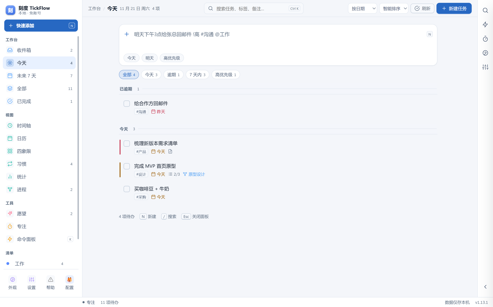

## 它解决什么问题

- 待办散在聊天、便签、邮件里，今天该做什么看不清。
- 事情有先后和依赖，普通清单排不出顺序。
- 想记录「这件事是怎么一步步做成的」，而不是只留一个完成勾。
- 专注计时、任务、统计分散在几个工具里，来回切换。

适合这些人：每天有 5 条以上待办、需要拆步骤和排顺序、希望数据留在本机、不喜欢被账号和订阅打扰的 Windows 用户。

## 当前版本

- 版本：**1.13.1**，Windows 10 / 11 64 位，正式可用。
- 安装包未做代码签名，首次运行会出现 SmartScreen 提示，按下面的步骤继续即可。

## 下载与安装

1. 打开 [Releases](https://github.com/si-zero-0/tickflow/releases/latest)（仓库主页：[si-zero-0/tickflow](https://github.com/si-zero-0/tickflow)）。
2. 下载 `TickFlow-Setup-1.13.1.exe`（文件名以最新 Release 为准）。
3. 双击安装。默认装到 `%LOCALAPPDATA%\Programs\TickFlow`，不需要管理员权限，可以改安装目录。
4. 如果出现「Windows 已保护你的电脑」：
   - 点「更多信息」；
   - 点「仍要运行」。
   
   这是因为安装包暂未购买代码签名证书，不是病毒提示。

安装完成后，开始菜单和桌面会有 TickFlow 快捷方式。

## 三步上手

**第一步：下载安装。** 同上，双击 `TickFlow-Setup-<版本>.exe`。

**第二步：打开后先做一件事。** 在「今天」页底部输入框写一条待办，回车即可。想拆步骤就到「进程」页；想计时就到「番茄钟」页。

**第三步：知道数据在哪、怎么卸载。**
- 数据在 `%APPDATA%\TickFlow`。也可以在「设置 → 数据 → 打开数据目录」直接打开。
- 卸载：Windows 设置 → 应用 → 已安装的应用 → TickFlow → 卸载。
- 卸载默认**保留**数据；确认不再使用后，手动删除 `%APPDATA%\TickFlow` 即可。

## 第一次打开会看到什么

- 左侧栏：工作台、视图、工具、清单四个分组，共 12 个视图。
- 中间：今天页的英雄区、快速输入框和任务列表。
- 右侧：当前专注、愿望和今日统计。
- 底部状态栏：待办数量、专注状态和版本。
- 首次启动会带几条示例任务，可以直接删掉，也可以拿来熟悉操作。

不需要登录，也没有引导弹窗。

深色外观（设置 → 外观可切换浅色 / 深色 / 跟随系统）：

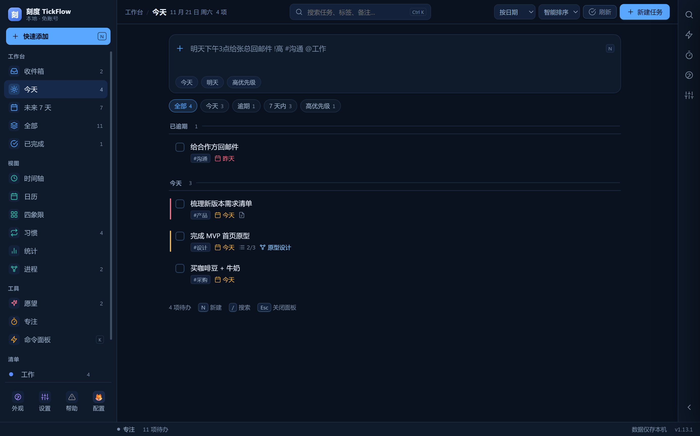

## 功能详解

### 任务与清单

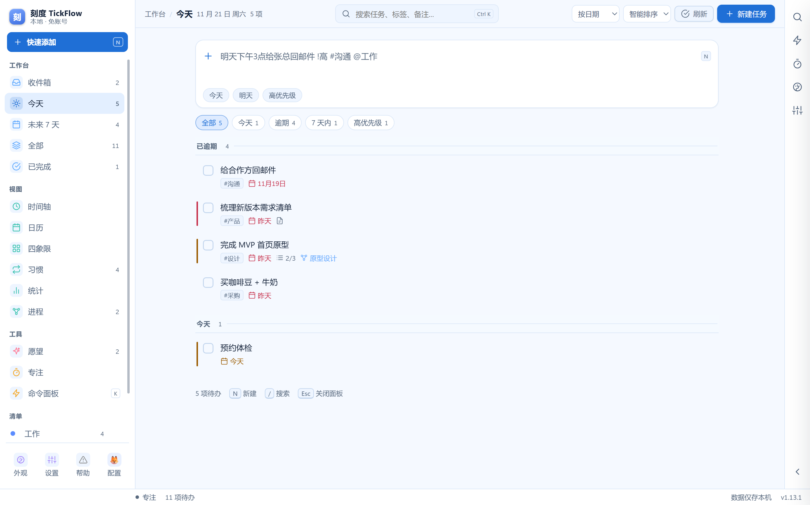

左侧「工作台」按收件箱、今天、未来七天、全部、已完成分开，每项带未完成数量。今天页顶部是快速添加框，支持 `!1`–`!3` 优先级、`#标签`、`@清单` 和「今天 / 明天」等写法，回车即建任务。带子任务的行会显示「2/3」进度，已完成任务留在「已完成」里，不会消失。

### 四象限

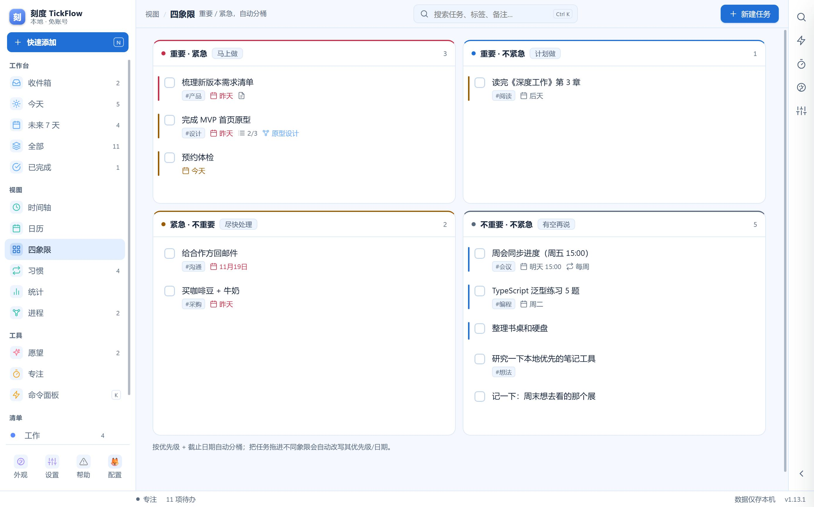

「视图 → 四象限」按重要 / 紧急自动分桶，每格右上角显示任务数。把任务拖到别的象限会改写它的优先级或日期，适合先决定「现在先做哪一件」。分桶规则写在页面底部，不用记。

### 时间轴

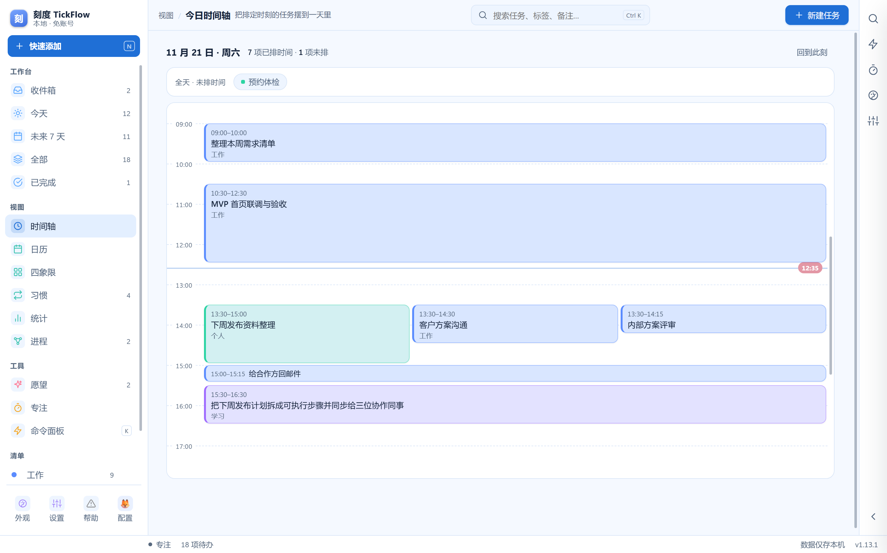

「视图 → 时间轴」把今天带时刻的任务摆到 24 小时刻度上。整点单块、跨小时长块、同一时间开始的多个任务会自动分列，15 分钟短块用单行紧凑显示，长标题最多两行。左侧时刻刻度固定可见，滚动区域自动定位到当前时间附近。

### 日历

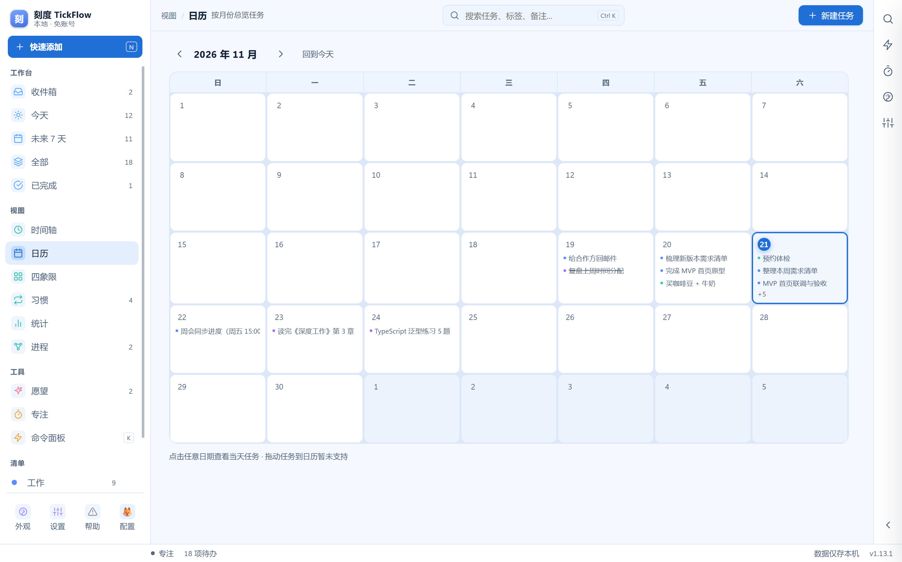

「视图 → 日历」按月查看任务分布，每个日期格列出当天任务，今天用强调色描边。点日期进入当天任务视图，点任务打开详情，适合排周期和找空档。

### 习惯

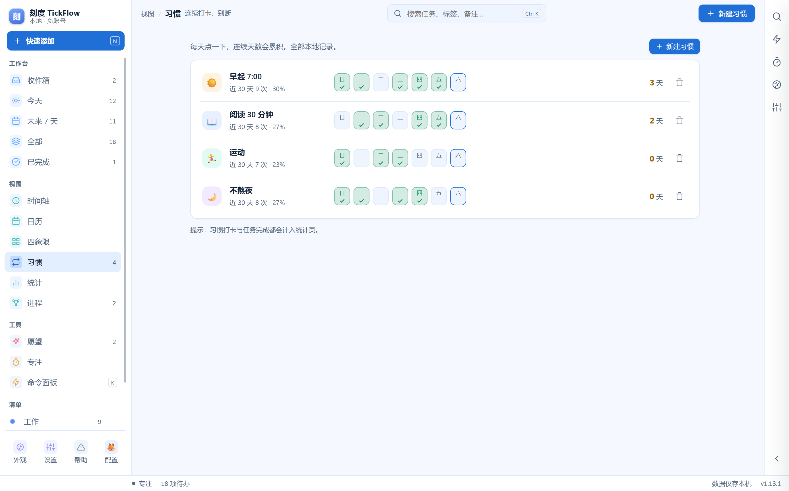

「视图 → 习惯」每天点一下打卡，右侧一周圆点记录最近状态。连续天数、近 30 天完成率会即时更新；打卡与任务完成都会计入统计页。

### 统计

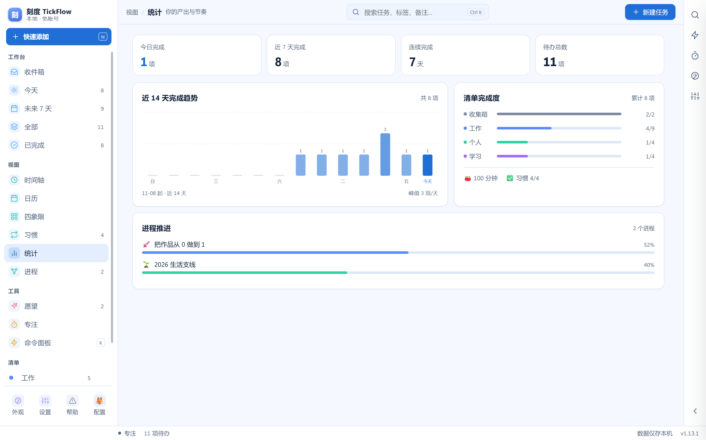

「视图 → 统计」把今日 / 近 7 天完成、连续天数、清单完成度、近 14 天趋势和进程进度放在一页。数据来自本机任务与专注记录，不需要联网，适合每周复盘一次。

### 专注（番茄钟）

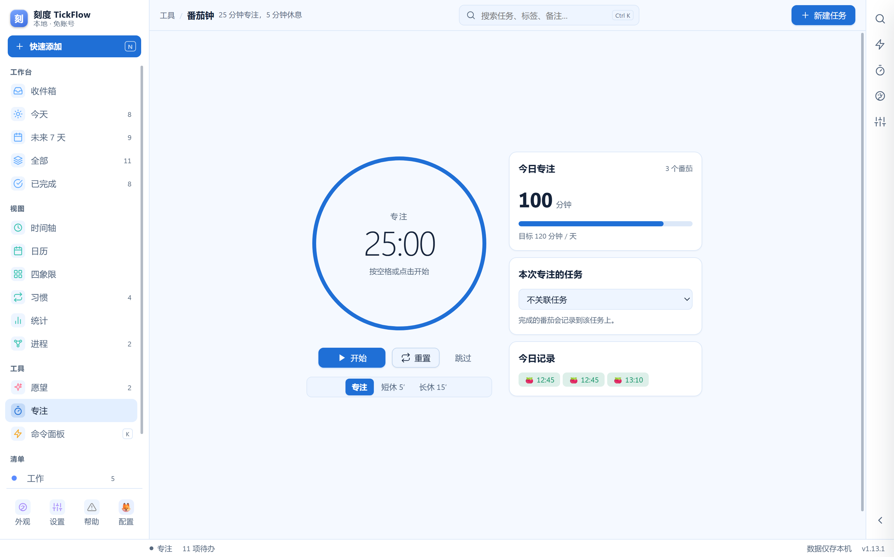

「工具 → 专注」默认 25 分钟工作、5 分钟短休息、15 分钟长休息，空格开始或暂停。可以把本次专注关联到某条任务，结束后自动记到任务和统计。今日记录按时间列出，时长可在「设置 → 通用 → 专注」里调整。

### 进程管理

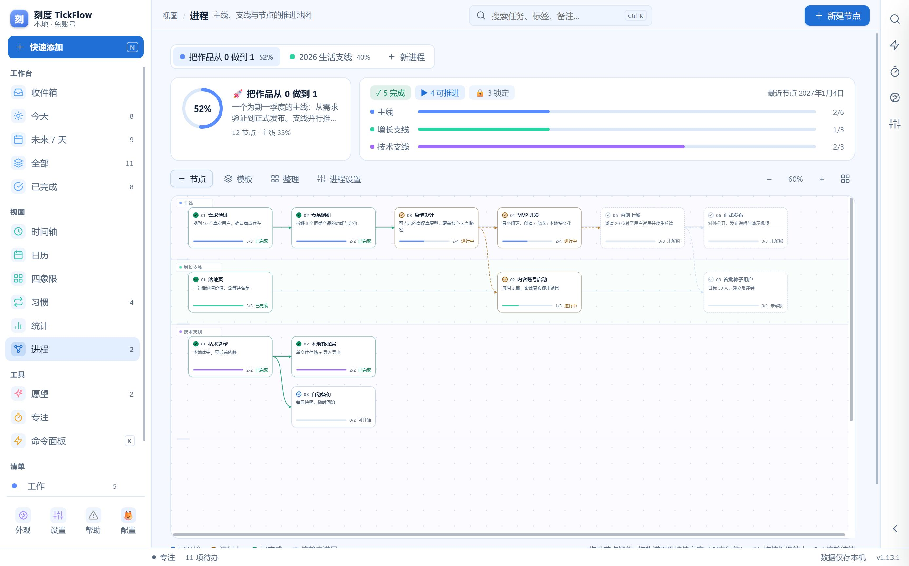

「视图 → 进程」把长期目标拆成主线与支线节点，节点之间有依赖箭头，前置完成后后续节点变为「可推进」。每个节点可放清单、状态和到期日；画布支持缩放与拖拽，节点多时点「适应宽度」。

### 命令面板

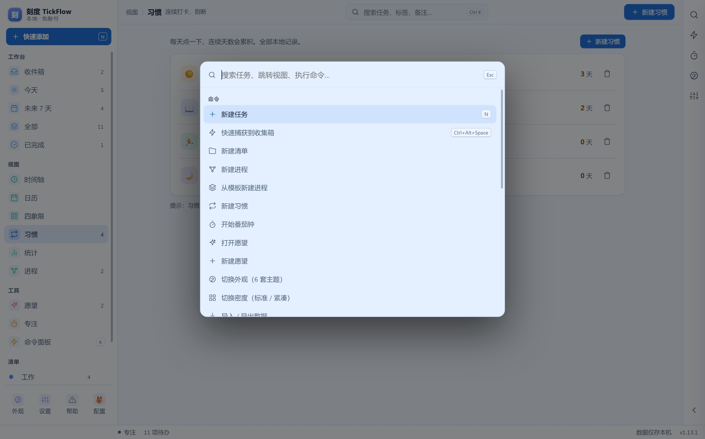

`Ctrl + K` 打开命令面板，输入关键词即可跳视图、建任务、开专注或切换外观。上下键选择、回车执行、`Esc` 关闭；面板里的操作全部发生在本地。

### 全局快速捕获

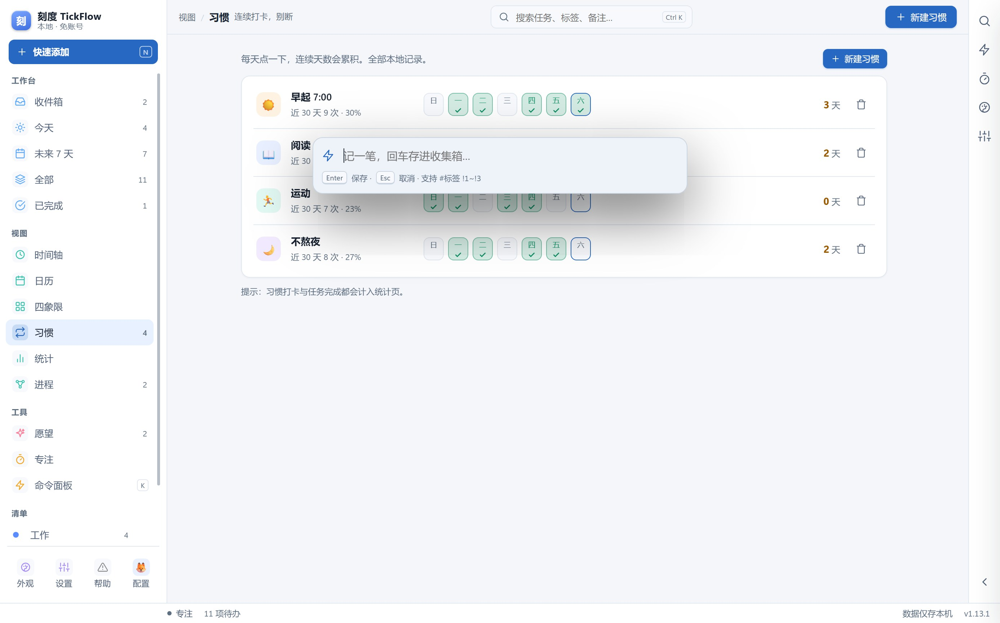

`Ctrl + Alt + Space` 在任何软件里呼出快速捕获，输入一句话回车就存进收集箱。支持 `#标签` 和 `!1`–`!3` 优先级，不用先切回 TickFlow；详细拆分可以稍后在任务详情里做。

### 导入导出与快照

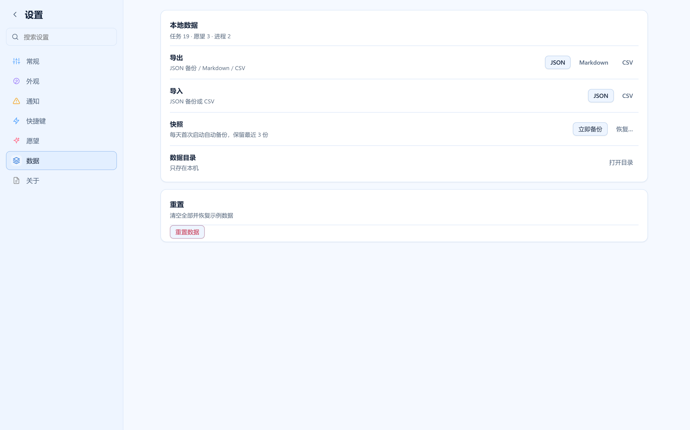

「设置 → 数据」可以导出 JSON / Markdown / CSV，换电脑时在新机器导入 JSON 或 CSV。应用每天首次启动自动留一份快照，保留最近 3 份；误删或误改可在同一页恢复。


## 常用操作

| 想做什么 | 怎么做 |
|---|---|
| 快速记一条待办 | 今天页底部输入框，回车 |
| 在别的软件里快速记录 | `Ctrl + Alt + Space` 打开快速捕获 |
| 切换视图 | 左侧栏「视图」分组，或命令面板 |
| 搜索任务 | 顶栏搜索框，或命令面板 |
| 开始专注 | 番茄钟页，或右侧栏的专注入口 |
| 记录愿望 | 左侧栏「愿望」 |
| 调整字号 / 配色 | 设置 → 外观 |
| 检查更新 | 设置 → 关于 → 更新 → 检查更新 |

常用快捷键：

- `Ctrl + Alt + Space`：全局快速捕获
- `Ctrl + K`：命令面板
- `N`：新建任务（输入框内不触发）
- `Esc`：关闭抽屉、弹窗或面板

## 数据、备份与卸载

- 数据位置：`%APPDATA%\TickFlow`，任务、愿望、专注记录、设置都在这里。
- 备份：设置 → 数据 → 导出 JSON；换电脑时在新机器导入。
- 自动快照：应用会在本地保留最近几份快照，误操作后可在设置 → 数据里恢复。
- 卸载不会删除数据；重装后数据仍在。

## 更新

- 打开「设置 → 关于 → 更新」，点「检查更新」。
- 发现新版本后，点「下载并校验」；下载完成会校验 SHA256，再点「安装并重启」。
- 应用启动后也会自动检查一次，之后每 24 小时检查一次。
- 下载源依次尝试 GitHub、ghproxy 镜像；都失败时会提示打开发布页手动下载。
- 更新失败不会影响当前版本，旧版本会保留。

## 常见问题

**SmartScreen 说未知发布者，能装吗？**
能。安装包暂未签名，按「更多信息 → 仍要运行」继续。后续版本会考虑购买证书。

**需要联网吗？**
日常使用不需要。只有检查更新和下载安装包时会访问网络。

**需要账号吗？**
不需要。没有登录、云同步、支付。

**数据会上传吗？**
不会。数据只在本机。

**更新下载失败怎么办？**
在「设置 → 关于」打开发布页，手动下载最新安装包覆盖安装；数据不会丢。

**卸载后数据还在吗？**
在。需要彻底清理时手动删除 `%APPDATA%\TickFlow`。

遇到问题先看上面的常见问题，仍未解决可在 B 站或 Issues 反馈。

## 反馈

- B 站（主要反馈入口）：[space.bilibili.com/1138070117](https://space.bilibili.com/1138070117)
- GitHub 仓库：[github.com/si-zero-0/tickflow](https://github.com/si-zero-0/tickflow)
- GitHub Issues：[github.com/si-zero-0/tickflow/issues](https://github.com/si-zero-0/tickflow/issues)

反馈时请说明：系统版本、TickFlow 版本、复现步骤；能附截图更好。

## 开发

<details>
<summary>构建、目录结构与自检（开发者向）</summary>

技术栈：Electron 主进程 + 原生 HTML/CSS/JS 渲染层，无前端框架、无构建器、无后端。

```powershell
# 安装依赖（首次）
npm --prefix src/main i

# 开发启动
npm --prefix src/main start

# 同步 stage 并启动
npm run stage
cd src/main
npx electron stage

# 自检与单测
npm run verify
npm test

# 打安装包（产物在 build/release）
npm run build
```

更完整的架构、目录、打包与发布说明见 [docs/DEVELOPMENT.md](docs/DEVELOPMENT.md)。

</details>
